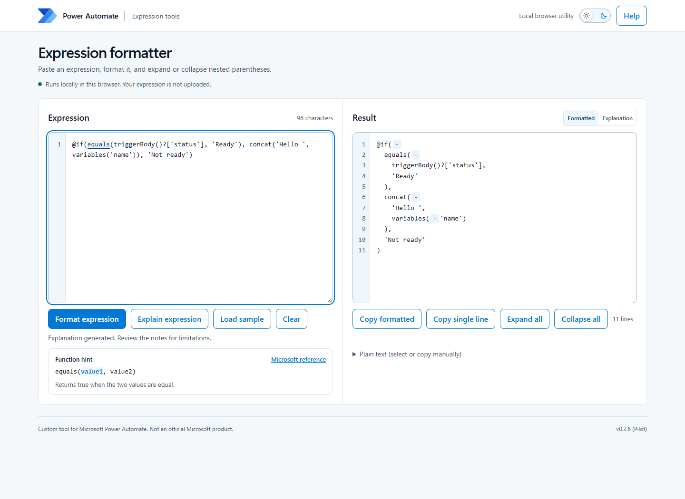

# Power Automate Expression Formatter

Make long Power Automate expressions easier to read, explore, and explain.

**v0.2.6 (Pilot)** | [Try it online](https://akmsft.github.io/power-automate/tools/expression-formatter/) | [Download the HTML file](https://github.com/akmsft/power-automate/releases/download/expression-formatter-v0.2.6/power-automate-expression-formatter.html)

## Get started

**Online:** open the [live tool](https://akmsft.github.io/power-automate/tools/expression-formatter/) in a modern browser.

**Offline:** download `power-automate-expression-formatter.html` from the [release](https://github.com/akmsft/power-automate/releases/tag/expression-formatter-v0.2.6), then double-click it to open it in Edge or Chrome. No installation, account, internet connection, or additional files are needed to run the downloaded tool.

If you download or clone the whole repository instead, open `tools/expression-formatter/index.html`. GitHub's file preview displays the source code, not the running tool.

1. Paste your expression into the left editor, or select **Load sample**.
2. Select **Format expression**, or press **Ctrl+Enter**.
3. Expand or collapse nested groups using **+ / -**.
4. Use **Copy formatted** or **Copy single line** to copy the complete expression, including collapsed sections.
5. Select **Explain expression** for a concise Summary, Steps, and Notes. Review the notes before using the expression in a flow.

Formatting does not change your input. Editing clears earlier results; format again when ready. The **Help** drawer covers shortcuts, diagnostics, copying, and limitations.

## Features

- Indented, collapsible output with input and result line numbers.
- Function hints and Microsoft reference links for common functions.
- Matching-parenthesis and current-function highlights while editing.
- Structural diagnostics and checks for argument counts and empty argument slots.
- A compact, movable issue overlay with Previous/Next navigation.
- Local, rule-based explanations of recognized expression logic.
- Two copy formats, with manual-copy fallback if clipboard access is blocked.
- Light and Fluent Graphite dark themes, controlled by a sun/moon switch.

## What this tool does - and does not - validate

This tool is for **Power Automate cloud-flow expressions (Workflow Definition Language)**. It is not a Power Fx editor and does not format entire flow definitions or JSON documents.

Structural errors, incorrect argument counts for cataloged functions, and empty argument slots block formatting, explanations, and copying. Unknown functions produce warnings: they may be valid functions missing from this tool's catalog, so formatting is still allowed.

The tool does **not** execute expressions, connect to your flow, check whether referenced actions or variables exist, or fully validate types, values, and runtime behavior. Explanations use local rules, not an AI service, and cannot infer your business context.

**No errors or warnings is not a guarantee that an expression will run successfully. Always review and test it in your flow.**

## Privacy and theme preferences

Expression processing happens in your browser. The tool does not upload expressions, use analytics, or call an external service to format or explain them. Microsoft reference links open external documentation only when you select them.

The downloaded HTML is self-contained, including its logo and favicon. Opening the live version downloads the application from GitHub Pages; GitHub's hosting policies apply to that request.

Only your chosen theme and its expiry are saved in browser storage, never your expression. Light is the default regardless of your operating system's theme. Each explicit toggle remembers your choice for 30 days. If storage is blocked, switching still works for the current page and a notice explains that the choice could not be saved. Moving the downloaded file or using a different browser may reset the preference.

## Feedback and reporting issues

This is a pilot release. [Open an issue](https://github.com/akmsft/power-automate/issues/new) and include:

- Tool version and browser.
- What you expected and what happened.
- A small, sanitized expression that reproduces the issue, if possible.

**GitHub issues are public. Do not include credentials, personal information, customer data, or private flow details.**

## Source, license, and acknowledgments

`index.html` is the complete application: HTML, CSS, and JavaScript in one file. There are no build steps or runtime package dependencies.

The formatter's original code is available under the [MIT License](LICENSE). This license is scoped to this folder and does not relicense the solution packages elsewhere in the repository.

Microsoft and Power Automate names and logos are trademarks of Microsoft. No trademark rights are granted by the MIT license. The embedded transparent logo was obtained from [Wikimedia Commons](https://commons.wikimedia.org/wiki/File:Microsoft_Power_Automate.svg), whose file page lists it as a public-domain text logo with trademark restrictions.

Community-built by Aaron Kuhn with AI-assisted development. **Not an official Microsoft product, and not endorsed or supported by Microsoft.**
